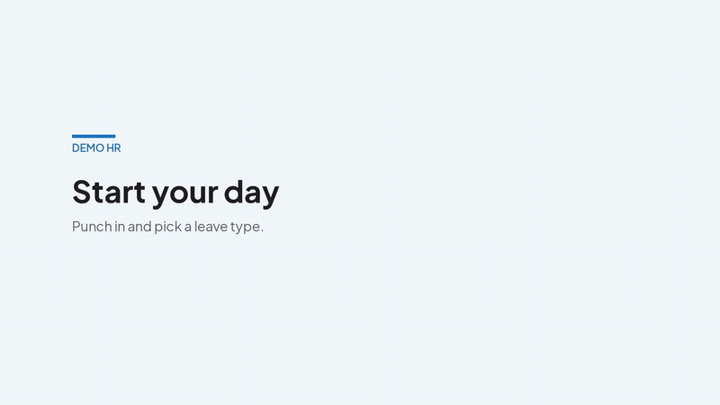
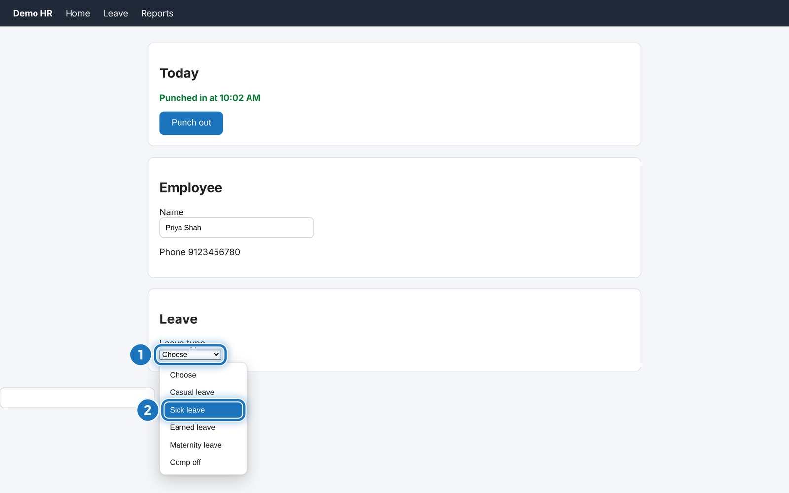
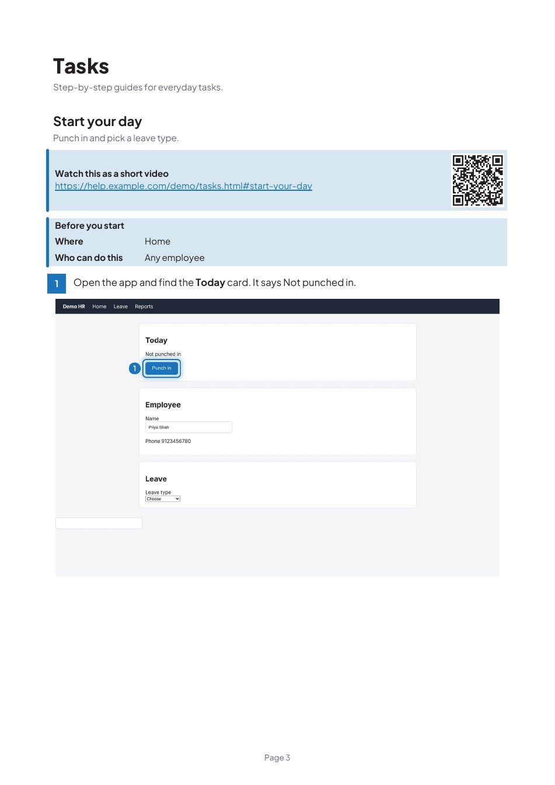

# Docyfy

A Claude skill that writes click-by-click user guides for web apps. It opens your app, takes sharp screenshots, rings each click target with a numbered highlight, and builds the guide. It can also record each task as a 4K video with a gliding cursor, captions and no audio.

You can get any of these:

- A PDF with contents, page numbers and bookmarks
- A Word file
- A one-page cheat sheet per module
- A searchable help site you can host, with a `help-map.json` to link from inside your app
- A 4K MP4 for each task (and a GIF too, if you ask for one)

Guides can cover the whole app, chosen modules, or single tasks like "how to punch in".

## See it in action

Everything below was made by Docyfy itself against a small demo HR app. Nothing was edited by hand.



The same task rendered in Hindi: [`docs/demo-hi.gif`](docs/demo-hi.gif). Full quality MP4s (1080p, 60 fps): [English](docs/demo.mp4) and [Hindi](docs/demo-hi.mp4). The skill renders 4K too, these are smaller to keep the repo light.

| A highlighted step | A page of the PDF |
| --- | --- |
|  |  |

The dropdown is drawn open because browsers do not show native lists in screenshots. The QR code in the PDF links to the video on your help site.

## What you need

- Claude Code, or any tool that supports skills (see the table below).
- Node 16 or newer and Python 3.9 or newer.
- Google Chrome. The skill drives the one you have, so there is no browser download. If Chrome is missing, the installer fetches Chromium.
- `ffmpeg` for videos (`brew install ffmpeg`). Not needed for PDFs.

## Install

One command. It finds the AI tools on your machine, copies the skill into each one, and installs the Python packages into their own virtualenv at `~/.docyfy/venv`, so your system Python stays untouched.

```bash
npx github:RandomKid24/adys-docyfy-skill
```

It prints what it found and asks once. Restart your AI tool afterwards. To update, run the same command again.

| Tool | Skills folder | Confidence |
| --- | --- | --- |
| Claude Code | `~/.claude/skills` | Documented |
| OpenCode | `~/.config/opencode/skill` | Documented |
| Codex CLI | `~/.codex/skills` | Best effort |
| Gemini CLI | `~/.gemini/skills` | Best effort |
| Cursor | `~/.cursor/skills` | Best effort |

Best effort means the folder is a guess. If the tool does not pick the skill up, check its docs for where skills go and use `--target`.

```bash
npx github:RandomKid24/adys-docyfy-skill --yes          # no question, install everywhere found
npx github:RandomKid24/adys-docyfy-skill --project      # this project only (./.claude/skills)
npx github:RandomKid24/adys-docyfy-skill --tool claude  # one tool only
npx github:RandomKid24/adys-docyfy-skill --target ~/my/skills
npx github:RandomKid24/adys-docyfy-skill --list         # show what it found, change nothing
npx github:RandomKid24/adys-docyfy-skill --uninstall
npx github:RandomKid24/adys-docyfy-skill --no-deps      # skip the Python virtualenv
npx github:RandomKid24/adys-docyfy-skill --no-browser   # never download Chromium
```

### Install by hand

```bash
git clone https://github.com/RandomKid24/adys-docyfy-skill ~/.claude/skills/docyfy
python3 -m venv ~/.docyfy/venv
~/.docyfy/venv/bin/pip install -r ~/.claude/skills/docyfy/requirements.txt
echo ~/.docyfy/venv/bin/python > ~/.claude/skills/docyfy/.python
```

The folder must be named `docyfy`. `pytesseract` is optional. It powers `check_guide.py --ocr`, which scans finished screenshots for readable personal data, and needs the `tesseract` program too.

## Use it

Type `/docyfy` and add words to pick the output.

| Command | You get |
| --- | --- |
| `/docyfy` | Claude asks what to make |
| `/docyfy pdf` | PDF and cheat sheets |
| `/docyfy video` | MP4 recordings only |
| `/docyfy video gif` | MP4 and a GIF for each task |
| `/docyfy word` | Word file |
| `/docyfy site` | Help site |
| `/docyfy all` | Everything above |
| `/docyfy video punch-in 4k` | A 4K video of one task |

Words combine (`/docyfy pdf video`). Add `draft`, `1080p`, `4k` or `8k` to set video quality. Or just describe it in plain language:

> /docyfy make step-by-step guides for these tasks in https://staging.example.com: how to punch in, how to apply for leave

Claude asks a few things once: the scope, where to capture (local, staging or production), your accent colour and logo, and who the readers are. Production is look-only and real data is blurred.

Each task starts at the first screen the reader sees and ends at the confirmation message. Every step has a screenshot with the target highlighted and numbered, a "Before you start" box, and a table of the form fields.

## How capture works

When the app opens from your computer (localhost, staging or a demo link), the skill runs `scripts/capture.py`:

- Screenshots are 2x sharp. A 1440 px window gives a 2880 px picture.
- Highlight boxes are measured from the page, so they sit exactly on the target.
- A three-step task captures in about 10 seconds. Claude does not spend a turn on each click.
- You sign in yourself, once, in a window the script opens (`capture.py login`). The skill never types your password.
- On production it only looks. It never clicks, types or submits.

If the app is not reachable from your machine (single sign-on, captcha, private network), Claude falls back to browser tools and takes screenshots one click at a time.

## Videos

Videos come from a studio renderer. It takes sharp stills of each page state, then draws the cursor, zoom, captions, click ripples and fades itself at 60 frames per second. Nothing is screen-recorded, so motion is even and the resolution is real.

The caption box is frosted glass: slightly see-through, with the page behind it blurred so the text stays sharp. It moves to the top of the window when the bottom spot would cover the button being clicked. A finished video has a title card, the recording in a Mac-style window, a "Step 2 of 4" chip on each caption, a smooth zoom toward each click target, a cursor that curves to the target and squeezes on the click, and an end card.

Set options in the capture spec header:

| Key | Default | What it does |
| --- | --- | --- |
| `quality` | `4k` | `4k` (3840x2160, 60 fps), `1080p`, `draft` (1080p, 30 fps, renders in seconds), `8k` |
| `zoom`, `zoom_level` | on, 1.3 | Zoom toward click targets |
| `cards` | on | Title and end cards |
| `highlight` | `auto` | `auto` shows the caption on click steps and a soft ring on look-only steps. `full` rings every mark. `caption` shows captions only |
| `engine` | `studio` | `live` records the browser as it runs (1280 px, less smooth) |

Use `draft` while checking and `4k` for the final pass. 4K takes a few minutes per task on a laptop and is much faster on a Mac with ffmpeg's VideoToolbox encoder.

### Hindi, Marathi and English (captions only)

Add `"langs": ["en", "hi", "mr"]` to the spec, or say `hi` or `mr` after the command. One video is rendered per language from the same captured stills, so extra languages only cost render time. Captions, step chips, title and end cards all switch language. Claude writes the Hindi and Marathi step text for you.


### Dropdowns

A native dropdown step shows the list open. In the video the list opens, the cursor glides to the option, the option highlights, and it is clicked. In the PDF the screenshot shows the open list with the chosen option numbered.

A PDF cannot play video. Recordings live in the help site. If you host the site, pass its address (`--site-url`) and each task in the PDF gets a "Watch this as a short video" link with a QR code.

## What it writes

Everything goes in a workspace folder, so a stopped run picks up where it left off.

| Path | What is in it |
| --- | --- |
| `docyfy.md` | Memory file. App, outputs, every task with its steps, version and timestamps, a change log and notes |
| `state.json` | Progress, brand settings, shared screenshots |
| `modules/<name>.json` | One module's steps, marks, fields and common problems |
| `shots/`, `annotated/` | Raw and highlighted screenshots |
| `gifs/` | MP4 recordings (and GIFs if asked) |
| `final/user-guide.pdf` | The guide |
| `final/user-guide.docx` | Word version |
| `final/cheatsheets/` | One A4 page per module, plus `all.pdf` |
| `final/site/` | Static help site with search and `help-map.json` |

## Keeping the guide current

When your app changes, ask Claude to update the guide. It compares saved page fingerprints, finds the screens that changed, and redoes only those. Help keys stay the same, so links from your app keep working.

### Memory for the next agent

Every script that finishes updates `docyfy.md` in the workspace. It holds the app, the outputs and when each was built, every task with its numbered steps, a version for each task, and a dated change log. When a step changes, the task goes up a version and the log says so. A new agent reads the top of the file and knows where things stand. Add your own notes with `progress.py note --ws W --text "Client wants Hindi on all videos"`. `journal.json` holds the full history.

## Claude in Chrome as a scout

For long or confusing flows, Claude can first walk the task in your own signed-in Chrome with the Claude in Chrome extension. It scrolls, opens every tab and wizard section, and notes each field. It writes the spec from that. Then `capture.py` takes the sharp screenshots and videos. Chrome is for learning the flow, `capture.py` is for the pictures. Details are in `references/scout.md`.

## Finding every field

`capture.py fields --url PAGE` prints every field on the page, whole page, marked REQUIRED or optional, with the tabs and the buttons at the bottom. Add `--json out.json` to get a starting `fields` table for the guide. The checker warns when a task ends on Next, never says what the reader sees at the end, or leaves a field without required or optional.

## Linking help from your app

The site build writes `help-map.json`, which maps a `help_key` to a page URL. Point your app's Help button at the key for the current screen.

```js
window.open(HELP_BASE + helpMap["customers/add-a-customer"])
```

## Change the look

Colours and fonts live in `scripts/theme.py`. Pass `--accent "#RRGGBB"` to `scripts/progress.py init` for one project. Highlights default to `spotlight`, a thick accent ring set a few pixels off the target with a soft glow. Pass `--style clean` for a plain dark outline or `--style sketch` for a hand-drawn pen look. The cache notices a style change and redraws.

## Repo layout

```
SKILL.md              short router Claude reads first (about 1k tokens)
references/           detail Claude reads only when a step needs it
assets/               shared steps (login, search, pagination) and fonts
scripts/              capture, studio, annotate, build_pdf, build_docx, build_site, build_cheatsheet, checks
bin/install.js        the npx installer
```

The skill is token optimized. `SKILL.md` stays small, each step loads its own reference file, clicking and drawing run in scripts, pages are read as text instead of pictures, and progress is saved so nothing is redone.

## Known limits

- Tested end to end on a demo app and sample data. Run it on one real task first and check that the highlights line up with your screens.
- The bundled font lacks the rupee sign in its main set. PDFs handle it. Images show "Rs".
- Apps behind single sign-on or captcha need the slower browser-tool capture.

The fonts are Plus Jakarta Sans under the SIL Open Font License (`assets/fonts/LICENSE-OFL.txt`).
